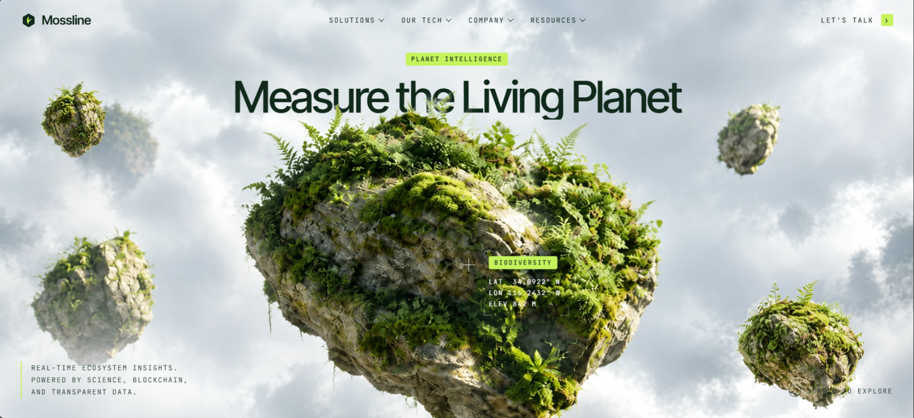
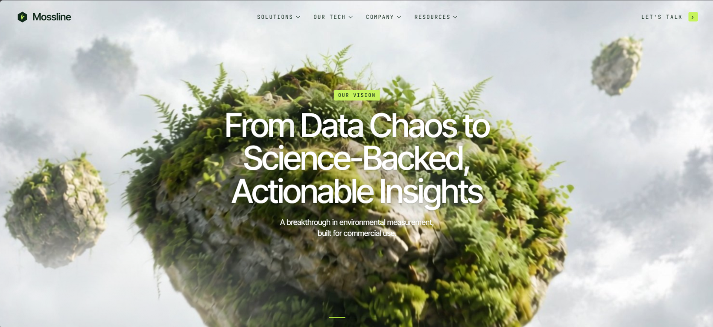
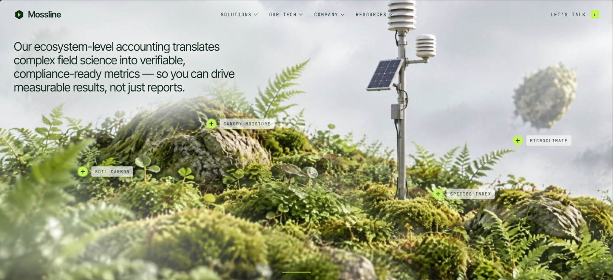
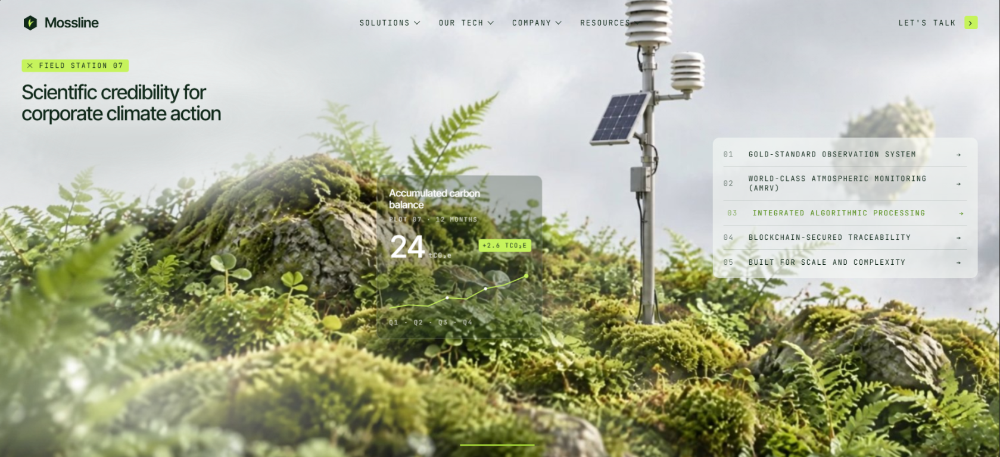
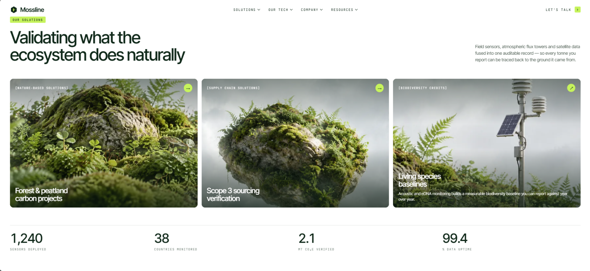

<div align="center">

# Mossline

### Environmental intelligence for a living planet

[](https://mossline-two.vercel.app)
[](https://vite.dev/)
[](https://developer.mozilla.org/docs/Web/HTML)
[](https://developer.mozilla.org/docs/Web/CSS)
[](https://developer.mozilla.org/docs/Web/JavaScript)
[](https://vercel.com/)

</div>

Mossline is an environmental intelligence website presenting how field observations and ecosystem data can support climate action. Its visual story introduces ecosystem measurement and solutions for nature-based carbon projects, supply-chain verification, and biodiversity baselines.

> **Scope note:** This repository contains a presentation website. The metrics displayed on the page are not confirmed as live or independently verified data.

## Features

- Scroll-led visual story with animated scenes and progress feedback.
- Interactive environmental indicator hotspots and feature highlights.
- Overview of forest and peatland carbon projects, Scope 3 sourcing verification, and species baselines.
- Conceptual carbon-balance and ecosystem metric visuals.

## Technology

- HTML, CSS, and JavaScript
- Vite for local development and production builds
- Git and GitHub for version control
- Vercel for hosting

> **Verify before updating:** The live page is implemented in `index.html`, while `package.json` and `vite.config.ts` also include React, TypeScript, and Tailwind-related tooling. Confirm which dependencies are actively used before describing them as part of the production site.

## Run locally

**Prerequisites:** [Node.js](https://nodejs.org/) and npm.

```bash
git clone https://github.com/Kiran240203/Mossline.git
cd Mossline
npm install
npm run dev
```

Open [http://localhost:3000](http://localhost:3000).

## Available commands

| Command | Description |
| --- | --- |
| `npm run dev` | Start the Vite development server. |
| `npm run build` | Create the production build in `dist/`. |
| `npm run preview` | Preview the production build locally. |
| `npm run lint` | Run the TypeScript check (`tsc --noEmit`). |

## Deploy with GitHub and Vercel

1. Push the project to a GitHub repository.
2. In Vercel, choose **Add New → Project** and import the repository.
3. Confirm the project settings: build command `npm run build` and output directory `dist`.
4. Deploy the project and verify the deployment at the Vercel URL.
5. After Git integration is enabled, pushes to the configured production branch can trigger production deployments. Pull requests can receive preview deployments when enabled in the Vercel project settings.

The live site is [mossline-two.vercel.app](https://mossline-two.vercel.app). **Verify** the production branch and Vercel build settings in the project dashboard; they are not documented in this repository.

## Screenshots

<p align="center">
  
  
</p>
<p align="center"><sub>Homepage · Vision</sub></p>

<p align="center">
  
  
</p>
<p align="center"><sub>Ecosystem insights · Field station</sub></p>

<p align="center">
  
</p>
<p align="center"><sub>Solutions</sub></p>
